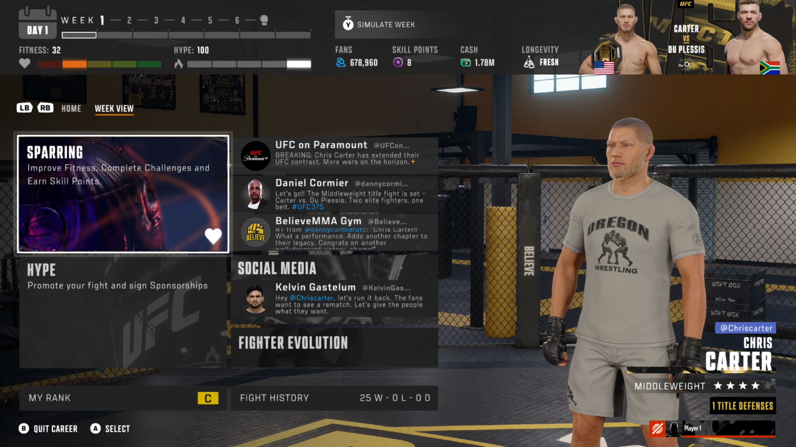
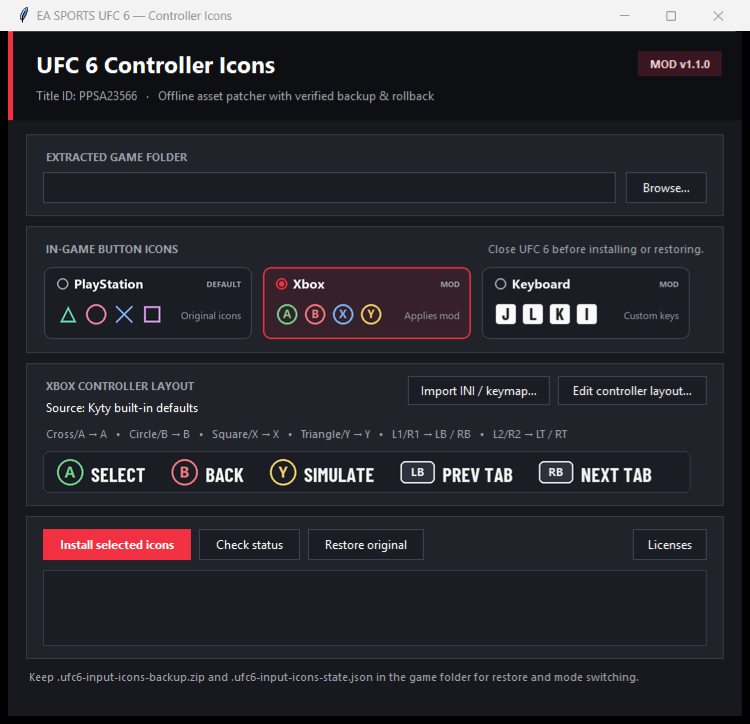

# UFC 6 Controller Icons

[**Download the latest release**](https://github.com/thyaguster/ufc6-xbox-icons/releases/latest)
| [Report an issue](https://github.com/thyaguster/ufc6-xbox-icons/issues)
| [Build from source](BUILD.md)


Choose **Xbox**, **keyboard/mouse**, or original PlayStation prompts for your
own extracted UFC 6 backup. Xbox mode reuses the game's existing artwork;
keyboard mode generates original, plain monochrome keycaps using your bindings.
No game executables, extracted textures, Flash libraries, saves, or keys are
included in the download.

## Supported build

| Item | Support |
| --- | --- |
| Title ID | **PPSA23566** |
| Game version | **01.006.000** |
| Standalone desktop application | Windows x64 |
| Source version | Python 3.10+; Tkinter; Pillow for keyboard artwork |
| Tested setup | UFC 6 launched through PORTHEON using its KytyPS5 engine |

The patcher checks the title/version and every affected original range before
writing. Other regions, game updates, and already-modified ranges are rejected.
It does not require a particular launcher folder or drive letter.

Career-menu A/B/Y and LB/RB icons were visually verified in game. The cinematic
hold-A skip prompt was also confirmed. Every live-fight prompt has not been
individually checked.





Keyboard J/Select and Cancel, I/Restart and Simulate, Q/E tab prompts, and Ctrl
were visually checked in-game using imported PORTHEON defaults. Other custom
bindings were exercised on disposable data; every live-fight prompt has not
been individually checked.

## Install

1. Download **UFC6-Xbox-Icons-v1.1.0.exe** from [Releases](https://github.com/thyaguster/ufc6-xbox-icons/releases/latest). Only this file is needed.
2. Close UFC 6.
3. Run the downloaded EXE.
4. Click **Browse** and choose the extracted game folder containing `Data` and
   `sce_sys/param.json`.
5. Choose an **Icon style**. For keyboard mode, load or review the bindings below.
6. Choose **Check status**, then **Install selected icons**.
7. Start the game normally through your launcher.

The Windows executable includes its patch profile and license notices: you
can copy and share just `UFC6-Xbox-Icons.exe`. No adjacent folders are required.
Use the **Licenses** button to view its notices.

The Windows executable does not need Python installed. The source launcher
requires Python 3.10 or later with Tkinter. Install the keyboard renderer with
`python -m pip install -r requirements.txt`. The patcher works offline and
does not download or upload anything.

### Keyboard bindings

- **PORTHEON:** choose **Load PORTHEON folder...**, or load `games/UFC6/UFC6.ini`
  with **Load settings file...**. Selecting a game folder also checks nearby
  PORTHEON locations. An absent/empty `keymap=` selects Kyty's built-in defaults.
- **Standalone Kyty:** choose **Kyty defaults**, import a JSON keymap, or load a
  launch `.cmd`, `.bat`, `.ps1`, `.txt` or Windows shortcut containing literal
  `--keymap` arguments. These files are read as data and are never executed.
- Review the 25 controller actions and their keyboard/mouse bindings. A small
  preview shows the resulting menu prompts. You can edit a selected binding.
- **Export...** saves JSON or a Kyty argument text file. **Copy Kyty (PowerShell)**
  copies a literal-quoted `--keymap` argument for a PowerShell launch command.
  Imported settings and launcher files are never overwritten.

Changing entries in this app only changes the icon labels: use the matching
exported keymap in Kyty to change actual controls. With PORTHEON, configure the
keys there, save, and reload the INI here. A custom Kyty keymap replaces the
default keyboard map; omitted actions are displayed as unbound. Duplicate keys
follow Kyty's replacement behavior, and left/right modifiers are treated as the
same key. Mouse left/right/middle and X1/X2 are supported. Reserved engine
shortcuts and unsupported key names are rejected.

Keyboard prompts are installed into game assets and stay selected when a
controller is used. They do not switch automatically with the last input device.
After changing launcher bindings, close the game and reinstall keyboard icons.
The patcher does not add keyboard input support; Kyty supplies that already.

### Restore and switch styles

Close the game, select the same game folder, and choose **Restore original**.
Or select another icon style and choose **Install selected icons**. Originals
are retained across binding updates and style changes.

Version 1.1 creates these local files **inside your game folder**:

- `.ufc6-input-icons-backup.zip`: verified original ranges.
- `.ufc6-input-icons-state.json`: installed hashes and the interrupted-write journal.

Keep both files. They are not part of the public download. A verified v1.0.x
`.ufc6-xbox-icons-backup.zip` is imported automatically and retained. While
keyboard mode is installed, older Xbox-only tools will reject the modified
artwork; use this patcher to restore or switch back to Xbox first. Keep the
patcher version that created your unified backup until restoration.

### Coming from the development installer

If the earlier experimental/development mod is installed, restore it using
that installer's `Set-XboxIcons.ps1 -Action Restore` first. This portable
release will not overwrite an existing mod without its own verified backup.
No need to restore an unmodified game.

### Game updates and repair

Restore before updating or repairing the game. If the game changes after
installation, the patcher stops instead of overwriting unknown data. Keep the
backup and use a matching clean game backup to resolve that mismatch.

If backup creation is interrupted before any game writes, a backup `.new` file
may remain. Keep it aside before retrying. The committed state and pending
journal allow recovery after interrupted writes; unknown later modifications
are rejected rather than overwritten.

## Command line

From the source directory:

Download the source ZIP or clone this repository. Keep its directory structure
intact. Run `Launch.cmd` for the desktop interface, or use these commands:

```powershell
python xbox_icons.py --status --game-dir "D:\Games\Extracted UFC 6"
python xbox_icons.py --install --style xbox --game-dir "D:\Games\Extracted UFC 6"
python xbox_icons.py --install --style keyboard --bindings "D:\PORTHEON\games\UFC6\UFC6.ini" --game-dir "D:\Games\Extracted UFC 6"
python xbox_icons.py --install --style keyboard --keymap "Cross=J;Circle=L;Options=Return" --game-dir "D:\Games\Extracted UFC 6"
python xbox_icons.py --restore --game-dir "D:\Games\Extracted UFC 6"
```

Non-icon entries already present in an imported `--keymap` (such as pad
mappings and mouse sensitivity) are retained when exporting. Text exports and
clipboard arguments use PowerShell quoting; JSON exports are shell-independent.

The Windows executable accepts the same flags. Add `--report report.json` to
capture its result when running it without a console.

## What is changed

Xbox mode:

- Maps 172 matching PlayStation/Xbox texture pairs; identical pixels need no write.
- Updates differing texture dimensions and the relevant asset hashes.
- Redirects 38 existing Flash symbol pairs to the matching Xbox graphics.
- Preserves archive sizes, resource identities, ActionScript, and input mappings.
- Makes 430 verified range edits across eight game asset files. No emulator
  executable, game executable, launcher configuration, or save is patched.

Xbox mode retains the original 430-range recipe. Keyboard mode manages a total
of 816 ranges, generates 328 texture prompts, and updates 110 existing Flash
bitmaps, including shared stick/d-pad prompts. Controller illustrations and
box art remain intact. Flash artwork changes preserve every non-bitmap tag,
including ActionScript, exported symbol names and sprite placements.

The public profiles contain only offsets, hashes, and transformation recipes.
Xbox replacement bytes come from the user's own game. Keyboard artwork is
generated locally from the included original renderer and open font.
All target handles and original ranges are checked before writes. A verified
backup is created first, and failed writes trigger rollback.

## Source and releases

`patcher_core.py` retains the original Xbox patcher. `input_icons.py` adds
keyboard generation, legacy-backup migration, mode switching and journaling.
`keyboard_bindings.py` imports keymaps; `keyboard_art.py` and
`keyboard_flash.py` generate artwork. `xbox_icons.py` provides the desktop and command-line interfaces.
`profiles/` contains the version-specific recipe. `tests/` contains source-only
tests; the game-data fixture used by the maintainer is deliberately excluded.

See [BUILD.md](BUILD.md) for the Windows executable build and
[RELEASE-NOTES.md](RELEASE-NOTES.md) for the release description.

This is an unofficial fan mod, not affiliated with EA, Xbox, Sony, PORTHEON,
or the KytyPS5 project. The MIT license applies to this patcher code and original artwork, not to
the game or its assets. The Windows build also includes the runtime components
listed in [THIRD-PARTY-NOTICES.md](THIRD-PARTY-NOTICES.md).
