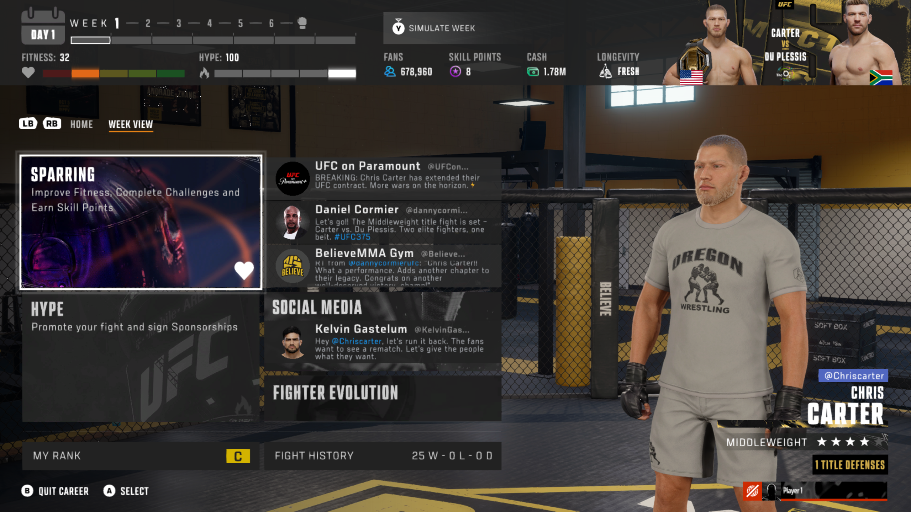

# UFC 6 Xbox Controller Icons

[**Download the latest release**](https://github.com/thyaguster/ufc6-xbox-icons/releases/latest)
· [Report an issue](https://github.com/thyaguster/ufc6-xbox-icons/issues)
· [Build from source](BUILD.md)


Replace PlayStation button prompts with the Xbox artwork already included in
your own extracted UFC 6 backup. Includes menu Flash symbols and texture-based
prompts. No game executables, textures, Flash libraries, saves, or game keys are
included in this download.

## Supported build

| Item | Support |
| --- | --- |
| Title ID | **PPSA23566** |
| Game version | **01.006.000** |
| Standalone desktop application | Windows x64 |
| Source version | Python 3.10+; Tkinter for the desktop UI |
| Tested setup | UFC 6 launched through PORTHEON using its KytyPS5 engine |

The patcher checks the title/version and every affected original range before
writing. Other regions, game updates, and already-modified ranges are rejected.
It does not require a particular launcher folder or drive letter.

Career-menu A/B/Y and LB/RB icons were visually verified in game. The cinematic
hold-A skip prompt was also confirmed. Every live-fight prompt has not been
individually checked.



## Install

1. Download **UFC6-Xbox-Icons-v1.0.1.exe** from [Releases](https://github.com/thyaguster/ufc6-xbox-icons/releases/latest). Only this file is needed.
2. Close UFC 6.
3. Run the downloaded EXE.
4. Click **Browse** and choose the extracted game folder containing `Data` and
   `sce_sys/param.json`.
5. Choose **Check status**, then **Install Xbox icons**.
6. Start the game normally through your launcher.

The Windows executable includes its patch profile and license notices: you
can copy and share just `UFC6-Xbox-Icons.exe`. No adjacent folders are required.
Use the **Licenses** button to view its notices.

The Windows executable does not need Python installed. The source launcher
requires Python 3.10 or later with Tkinter. The patcher works offline and
does not download or upload anything.

### Restore

Close the game, open the patcher, select the same folder, and choose
**Restore original**. Original bytes are restored and checked.

The installer creates `.ufc6-xbox-icons-backup.zip` **inside your game folder**.
Keep that file. It contains your local original ranges and is not part of the
public download. It remains after restoration so you can verify or reinstall.
Keep the installed patcher version until you have restored.

### Coming from the development installer

If the earlier experimental/development mod is installed, restore it using
that installer's `Set-XboxIcons.ps1 -Action Restore` first. This portable
release will not overwrite an existing mod without its own verified backup.
No need to restore an unmodified game.

### Game updates and repair

Restore before updating or repairing the game. If the game changes after
installation, the patcher stops instead of overwriting unknown data. Keep the
backup and use a matching clean game backup to resolve that mismatch.

If backup creation is interrupted before installation starts, a file named
`.ufc6-xbox-icons-backup.zip.new` may remain. No game writes happen before
the completed backup is verified. Keep that temporary file aside before retrying.

## Command line

From the source directory:

Download the source ZIP or clone this repository. Keep its directory structure
intact. Run `Launch.cmd` for the desktop interface, or use these commands:

```powershell
python xbox_icons.py --status --game-dir "D:\Games\Extracted UFC 6"
python xbox_icons.py --install --game-dir "D:\Games\Extracted UFC 6"
python xbox_icons.py --restore --game-dir "D:\Games\Extracted UFC 6"
```

The Windows executable accepts the same flags. Add `--report report.json` to
capture its result when running it without a console.

## What is changed

- Maps 172 matching PlayStation/Xbox texture pairs; identical pixels need no write.
- Updates differing texture dimensions and the relevant asset hashes.
- Redirects 38 existing Flash symbol pairs to the matching Xbox graphics.
- Preserves archive sizes, resource identities, ActionScript, and input mappings.
- Makes 430 verified range edits across eight game asset files. No emulator
  executable, game executable, launcher configuration, or save is patched.

The public profile contains only offsets, hashes, and transformation recipes.
All replacement bytes are generated from files on the user's own machine.
All target handles and original ranges are checked before writes. A verified
backup is created first, and failed writes trigger rollback.

## Source and releases

`patcher_core.py` implements validation, local patch generation, backups and
restoration. `xbox_icons.py` provides the desktop and command-line interfaces.
`profiles/` contains the version-specific recipe. `tests/` contains source-only
tests; the game-data fixture used by the maintainer is deliberately excluded.

See [BUILD.md](BUILD.md) for the Windows executable build and
[RELEASE-NOTES.md](RELEASE-NOTES.md) for the release description.

This is an unofficial fan mod, not affiliated with EA, Xbox, Sony, PORTHEON,
or the KytyPS5 project. The MIT license applies to this patcher code, not to
the game or its assets. The Windows build also includes the runtime components
listed in [THIRD-PARTY-NOTICES.md](THIRD-PARTY-NOTICES.md).
